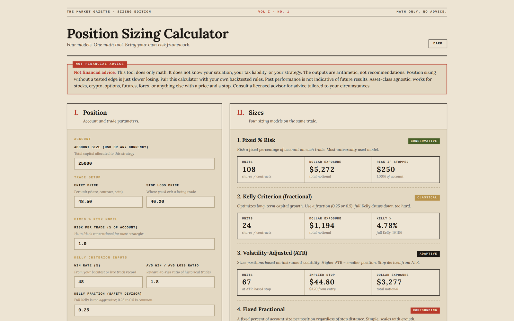

# position-sizing-calculator



**Live demo:** https://0xelitesystem.github.io/position-sizing-calculator/

> **Not financial advice.** This is a math calculator. It does no recommendations, no live data, no advice tailored to your situation. Position sizing without a tested edge is just slower losing. Pair this with your own backtested rules and a licensed advisor if you need one.

Four position sizing models on the same trade, side by side. Asset-class agnostic: works for stocks, crypto, options, futures, forex, anything with a price and a stop.

## What it does

You enter:
- Account size
- Entry price and stop loss price (for the trade you're sizing)
- Your risk parameters (% per trade, win rate, reward:risk ratio, Kelly fraction, ATR)

The tool returns position size in units, dollar exposure, and risk-if-stopped for four models:

1. **Fixed % risk**: risk a fixed percentage of account on each trade. Most universally used.
2. **Kelly criterion (fractional)**: capital growth math using win rate and reward:risk. Use a fraction (0.25 or 0.5) not full Kelly.
3. **Volatility-adjusted (ATR)**: sizes based on instrument volatility. Higher ATR means smaller position.
4. **Fixed fractional**: a fixed percent of account in the position regardless of stop distance.

The point of showing all four: they give different sizes on the same trade. The "correct" one depends on your edge, your psychology, and your capital base.

## Inputs explained

| Input | What it is |
|---|---|
| Account size | Total capital allocated to this strategy |
| Entry / stop | The two prices that define your risk per unit |
| Risk per trade (%) | 1% to 2% is conventional; 0.5% for early-stage strategies; 3%+ is aggressive |
| Win rate (%) | Historical or backtested percentage of trades that win |
| Avg win / avg loss | Reward-to-risk ratio of historical winning trades vs losing trades |
| Kelly fraction | Safety divisor on full Kelly. 0.25 ("quarter Kelly") is standard; 0.5 is aggressive; 1.0 (full Kelly) is reckless for retail |
| ATR | Average True Range; 14-day is common |
| ATR multiplier | How wide to set the stop relative to ATR; 1.5x to 3x typical |

## Outputs explained

For each model: **units**, **dollar exposure** (units × entry), and either **risk if stopped** (dollars at risk) or model-specific number (Kelly %, ATR-implied stop).

Color coding: amber if risk is over 2% of account, red if over 5% or if Kelly returns a negative edge (your win rate × RR doesn't beat the alternative).

## Use

[https://0xelitesystem.github.io/position-sizing-calculator/](https://0xelitesystem.github.io/position-sizing-calculator/)

Or open `index.html` locally.

1. Enter account size, entry price, and stop loss price.
2. Set risk per trade, win rate, avg win / avg loss ratio, Kelly fraction, ATR, and ATR multiplier.
3. Read units, dollar exposure, and risk for each of the four models. Results update as you type, or press Calculate.
4. Use Halve all risk % for a conservative pass, or Reset to start over.

## Why this exists

Comparing sizing models usually means a spreadsheet or a broker tool tied to your account. This is one HTML file that runs four models side by side in your browser, with no tracking, no account, and no network calls. MIT licensed.

## Privacy

Everything runs in your browser. Nothing you enter is sent anywhere or saved, and reloading resets every field. The only thing the page writes to your browser is your light or dark theme choice, saved in localStorage under the key `theme` when you press the theme button, so the page opens in the same theme next time. Clear site data to remove it.

## Run locally

```
git clone https://github.com/0xelitesystem/position-sizing-calculator
cd position-sizing-calculator
```

Then open `index.html` in any browser. Or serve the folder with `python -m http.server` and visit http://localhost:8000.

## Build

No build step. The whole tool is one file, `index.html`, with its CSS and JavaScript inline.

## Heavy disclaimer (read it)

- This tool is **math only**. It does no advice.
- It does not know your tax situation, your account type, your jurisdiction, your strategy, or whether you have any edge at all.
- A position size calculator without a tested edge just helps you lose at a controlled rate.
- The outputs are arithmetic, not recommendations.
- Past performance is not indicative of future results.
- Consult a licensed advisor for advice tailored to your circumstances.

## What this tool does NOT do

- No live market data; you type the prices.
- No connection to your broker.
- No trade execution.
- No saved state; reload resets everything.
- No backtest engine; you bring the win rate and RR from your own records.

## What's not included

- No localStorage for your inputs (only the theme choice, see Privacy), no cookies, no tracking.
- No third-party scripts.
- No paywall.

## More

Part of a catalog of single-file browser tools and plain-language references, all MIT licensed and dependency-free: [0xelitesystem.github.io](https://0xelitesystem.github.io/). Built by [elitesystem.ai](https://elitesystem.ai).

## License

MIT.
